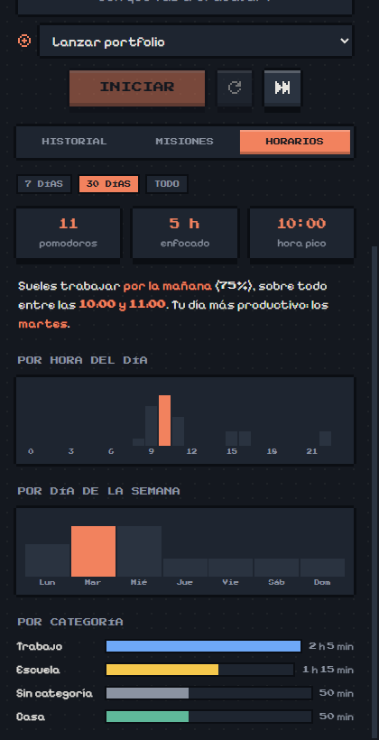

<p align="center">
  
</p>

<h1 align="center">Flow Now!</h1>

<p align="center">
  Temporizador Pomodoro de escritorio para Windows con estética pixel art de videojuego.<br />
  Registra en qué trabajas, agrupa tus pomodoros en <strong>misiones</strong> y descubre <strong>a qué horas</strong> sueles concentrarte.
</p>

<p align="center">
  
  
</p>

---

## Características

- **Pomodoro clásico**: enfoque, pausa corta y pausa larga, con duraciones configurables. La pausa larga llega sola cada N pomodoros. También puedes cambiar de fase cuando quieras con los botones de arriba.
- **Registro de tareas**: escribe en qué vas a trabajar y cada pomodoro queda guardado con su título, su día y su tramo horario (`10:00–10:25`). Los pomodoros interrumpidos se guardan atenuados como incompletos.
- **Misiones**: agrupa pomodoros bajo un objetivo mayor. Elige una misión y todo lo que hagas se registra en ella. Puedes marcarla como completada y ver su registro completo.
- **Categorías**: Trabajo, Casa, Escuela o la que escribas, cada una con su color y su filtro.
- **Horarios**: estadísticas de cuándo trabajas, con la hora pico, la franja del día (mañana, tarde o noche), el día más productivo y gráficas por hora, por día de la semana y por categoría. Puedes ver los últimos 7 o 30 días, o todo.
- **Estrellas de ciclo**: cada pomodoro completado enciende una ⭐ hasta la pausa larga.
- **Integración con Windows**: notificaciones nativas con sonido, icono en la bandeja con el tiempo restante y opción de ventana siempre visible. Al cerrar la ventana, la app sigue en la bandeja.
- **Modo claro y oscuro**: sigue automáticamente el tema de Windows.
- **Animaciones suaves** al interactuar. Se desactivan si Windows tiene activado *reducir movimiento*.
- **Sin cuenta ni internet**: todos los datos se guardan en local.

<p align="center">
  
  
</p>

## Instalación

1. Descarga o genera el instalador `flow-now-<versión>-setup.exe` (ver [Generar el instalador](#generar-el-instalador)).
2. Ejecútalo. Se instala para tu usuario, sin pedir permisos de administrador, y crea un acceso directo **Flow Now!** en el escritorio.

> El instalador no está firmado, así que Windows SmartScreen puede mostrar un aviso. Pulsa *Más información → Ejecutar de todas formas*.

## Uso

| Acción | Cómo |
| --- | --- |
| Empezar un pomodoro | Escribe la tarea y pulsa **Iniciar** (o `Enter`) |
| Pausar / reanudar | Botón principal |
| Reiniciar la fase | Botón ↺ (el tiempo hecho se guarda como incompleto) |
| Saltar a la siguiente fase | Botón ⏭ |
| Elegir una misión | Pestaña **Misiones** → **Elegir**. Aparece un selector bajo la tarea para cambiarla |
| Reutilizar un título | Clic en una tarea del **Historial** |
| Cambiar la categoría de una misión | Clic en el nombre de la misión → campo *Categoría* |
| Ajustes | Engranaje de arriba a la derecha |
| Salir del todo | Icono de la bandeja → **Salir** |

Solo se registran las fases de enfoque. Los pomodoros de menos de 1 minuto no se guardan.

## Datos

Todo se guarda en un único archivo JSON:

```
%APPDATA%\Flow Now!\data.json
```

Contiene `sessions` (pomodoros), `goals` (misiones), `activeGoalId` y `settings`. Se escribe de forma atómica (archivo temporal + renombrado), así que un cierre inesperado no lo corrompe. Para hacer una copia de seguridad, copia ese archivo.

## Desarrollo

Requisitos: **Node.js 20.19+ o 22+** y npm. Para regenerar el icono también necesitas Python con Pillow.

```bash
npm install
npm run dev          # app con recarga en caliente
npm run typecheck    # TypeScript (main + renderer)
npm run lint         # ESLint
npm run format       # Prettier
```

> Si `npm run dev` falla con `Cannot read properties of undefined (reading 'isPackaged')`, tu terminal tiene definida la variable `ELECTRON_RUN_AS_NODE`. Pasa en algunas terminales integradas. Bórrala (`unset ELECTRON_RUN_AS_NODE` / `Remove-Item Env:ELECTRON_RUN_AS_NODE`) y vuelve a intentarlo.

### Generar el instalador

```bash
npm run build:win    # → dist/flow-now-<versión>-setup.exe
```

### Stack

- [Electron](https://www.electronjs.org/) + [electron-vite](https://electron-vite.org/)
- React + TypeScript
- CSS propio, sin framework. Fuentes [Pixelify Sans](https://fonts.google.com/specimen/Pixelify+Sans) y [Press Start 2P](https://fonts.google.com/specimen/Press+Start+2P) empaquetadas con Fontsource, así que funciona sin conexión.
- [electron-builder](https://www.electron.build/) para el instalador NSIS

### Estructura

```
src/
  shared/types.ts            Tipos compartidos (Session, Goal, Settings) y valores por defecto
  main/
    index.ts                 Ventana, bandeja, notificaciones e IPC
    store.ts                 Lectura y escritura de data.json
  preload/                   API segura expuesta al renderer (window.api)
  renderer/src/
    App.tsx                  Estado global, pestañas y persistencia
    hooks/useTimer.ts        Lógica del temporizador (basada en hora de fin, no se desfasa)
    components/
      Timer.tsx              Reloj de bloques, fases, tarea y controles
      History.tsx            Historial agrupado por día
      Goals.tsx              Misiones y categorías
      Schedule.tsx           Estadísticas de horarios
      Settings.tsx           Modal de ajustes
      PixelIcon.tsx          Renderiza los iconos pixel art
    pixelArt.ts              Dibujos de los iconos como cuadrículas de caracteres
    assets/main.css          Estilos, paleta y animaciones
scripts/make-icon.py         Genera el icono de la app (.ico/.png) a partir de la ola
```

### Personalizar

- **Paleta**: variables CSS al principio de [`main.css`](src/renderer/src/assets/main.css), con un bloque para el modo oscuro y otro para el claro.
- **Iconos**: cada icono de [`pixelArt.ts`](src/renderer/src/pixelArt.ts) es una cuadrícula de texto. `#` usa el color del texto, las letras se mapean en `PALETTE` y `.` es transparente.
- **Icono de la app**: edita la ola en [`scripts/make-icon.py`](scripts/make-icon.py) y ejecuta `python scripts/make-icon.py`.
