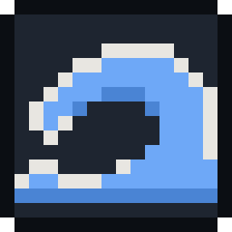
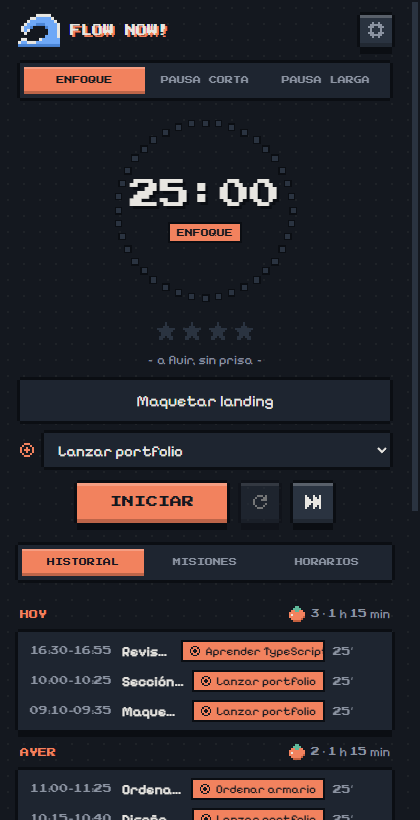
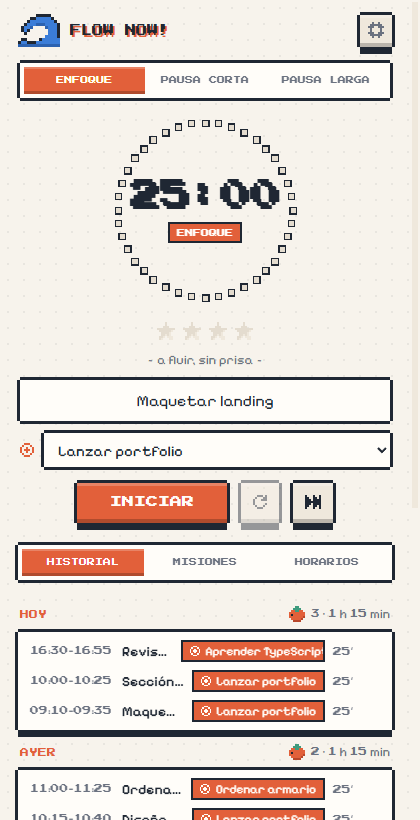
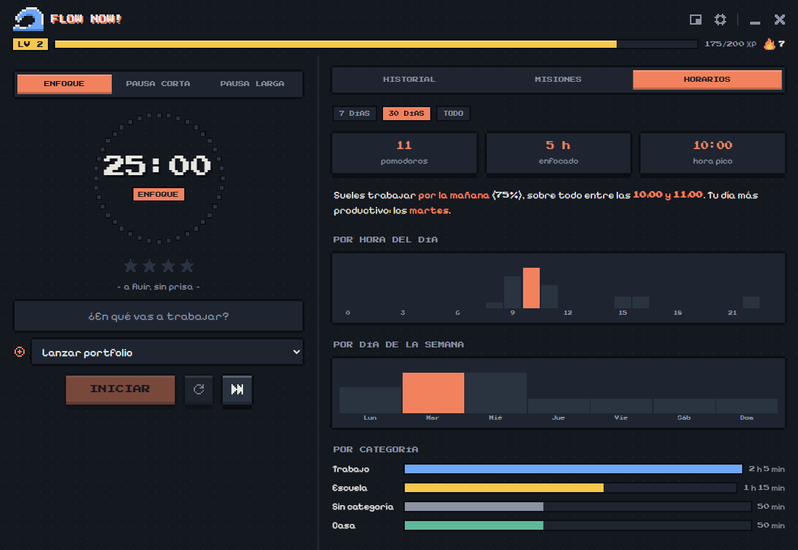
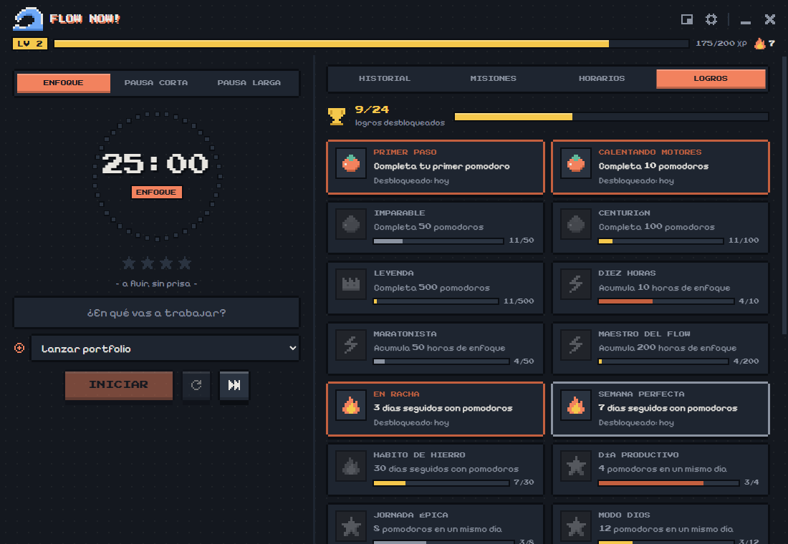
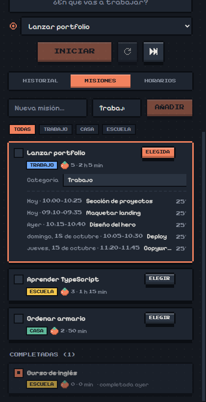
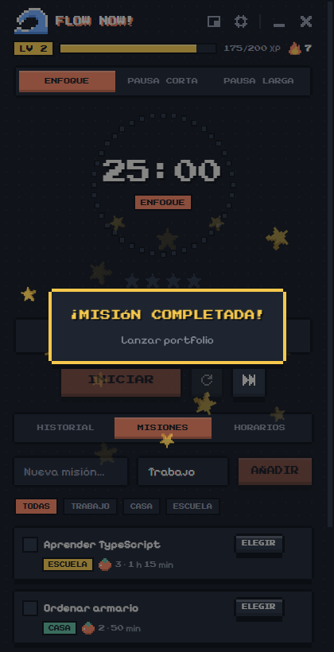
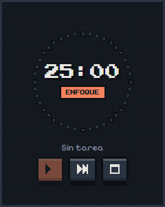

<p align="center">
  
</p>

<h1 align="center">Flow Now!</h1>

<p align="center">
  Temporizador Pomodoro de escritorio para Windows con estética pixel art de videojuego.<br />
  Registra en qué trabajas, agrupa tus pomodoros en <strong>misiones</strong> y descubre <strong>a qué horas</strong> sueles concentrarte.
</p>

<p align="center">
  
  
</p>

---

## Características

- **Pomodoro clásico**: enfoque, pausa corta y pausa larga, con duraciones configurables. La pausa larga llega sola cada N pomodoros. También puedes cambiar de fase cuando quieras con los botones de arriba.
- **Registro de tareas**: escribe en qué vas a trabajar y cada pomodoro queda guardado con su título, su día y su tramo horario (`10:00–10:25`). Los pomodoros interrumpidos se guardan atenuados como incompletos.
- **Misiones**: agrupa pomodoros bajo un objetivo mayor. Elige una misión y todo lo que hagas se registra en ella. Puedes marcarla como completada y ver su registro completo.
- **Categorías**: Trabajo, Casa, Escuela o la que escribas, cada una con su color y su filtro.
- **Horarios**: estadísticas de cuándo trabajas, con la hora pico, la franja del día (mañana, tarde o noche), el día más productivo y gráficas por hora, por día de la semana y por categoría. Puedes ver los últimos 7 o 30 días, o todo.
- **Estrellas de ciclo**: cada pomodoro completado enciende una ⭐ hasta la pausa larga.
- **Logros**: 24 logros de bronce, plata y oro (pomodoros, horas, rachas, días intensos, madrugador, búho nocturno, misiones, categorías y niveles), con su progreso y la fecha en que los conseguiste.
- **Nivel, XP y racha**: ganas 1 XP por minuto de enfoque, subes de nivel y llevas la cuenta de los días seguidos con pomodoros (🔥).
- **Celebraciones**: una explosión de estrellas pixel y efectos de sonido de 8 bits al completar un pomodoro, subir de nivel o terminar una misión.
- **Modo mini**: una ventanita flotante, siempre visible, con el anillo, el tiempo y los controles.
- **Dos columnas** al agrandar la ventana: el temporizador a la izquierda y el historial, las misiones o los horarios a la derecha.
- **Integración con Windows**:
  - Barra de título pixel art propia.
  - El icono de la barra de tareas muestra el progreso y su miniatura tiene botones ▶/⏸ y ⏭.
  - Notificaciones nativas.
  - Icono en la bandeja con el tiempo restante; al cerrar la ventana, la app sigue ahí.
  - Opción de ventana siempre visible.
- **Tema claro, oscuro o el del sistema**, a elegir en Ajustes.
- **Animaciones suaves** al interactuar. Se desactivan si Windows tiene activado *reducir movimiento*.
- **Sincronización con Google Drive** (opcional): usa la app en varios PC con el mismo progreso. Los datos van a una carpeta privada y oculta de tu Drive, y los cambios de cada equipo se fusionan sin perder nada.
- **Funciona sin cuenta ni internet**: si no conectas Google, todo se guarda solo en local.

<p align="center">
  
  
</p>

<p align="center">
  
  
  
</p>

## Instalación

1. Descarga o genera el instalador `flow-now-<versión>-setup.exe` (ver [Generar el instalador](#generar-el-instalador)).
2. Ejecútalo. Se instala para tu usuario, sin pedir permisos de administrador, y crea un acceso directo **Flow Now!** en el escritorio.

> El instalador no está firmado, así que Windows SmartScreen puede mostrar un aviso. Pulsa *Más información → Ejecutar de todas formas*.

## Uso

| Acción | Cómo |
| --- | --- |
| Empezar un pomodoro | Escribe la tarea y pulsa **Iniciar** (o `Enter`) |
| Pausar / reanudar | Botón principal |
| Reiniciar la fase | Botón ↺ (el tiempo hecho se guarda como incompleto) |
| Saltar a la siguiente fase | Botón ⏭ |
| Elegir una misión | Pestaña **Misiones** → **Elegir**. Aparece un selector bajo la tarea para cambiarla |
| Reutilizar un título | Clic en una tarea del **Historial** |
| Cambiar la categoría de una misión | Clic en el nombre de la misión → campo *Categoría* |
| Ajustes (duraciones, tema, sonidos) | Engranaje de la barra de título |
| Modo mini | Botón ▣ de la barra de título; vuelve con el botón ☐ de la ventanita |
| Controlar sin abrir la app | Pasa el ratón por el icono de la barra de tareas → ▶/⏸ y ⏭ |
| Salir del todo | Icono de la bandeja → **Salir** |

Solo se registran las fases de enfoque. Los pomodoros de menos de 1 minuto no se guardan.

## Datos

Todo se guarda en un único archivo JSON:

```
%APPDATA%\Flow Now!\data.json
```

Contiene `sessions` (pomodoros), `goals` (misiones), `activeGoalId`, `settings` y `achievements` (logros desbloqueados con su fecha). Se escribe de forma atómica (archivo temporal + renombrado), así que un cierre inesperado no lo corrompe. Para hacer una copia de seguridad, copia ese archivo.

## Sincronización con Google Drive

En **Ajustes → Sincronización → Conectar con Google** se abre el navegador para autorizar la app. Desde ese momento:

- Los datos se guardan en el **appDataFolder** de tu Drive: una carpeta oculta a la que solo accede Flow Now!. La app no puede ver el resto de tu Drive (scope `drive.appdata`).
- Se sincroniza al abrir la app, unos segundos después de cada cambio, al volver a la ventana y cada 2 minutos.
- **Fusión sin pérdidas**: los pomodoros y las misiones se unen por id. Si una misión se editó en dos equipos, gana la edición más reciente. Los borrados se respetan y de cada logro se conserva la fecha más antigua.
- Los **ajustes** (tema, duraciones) y la misión elegida son propios de cada equipo.
- El token de acceso se guarda cifrado con el almacén seguro de Windows (DPAPI).

### Configurar las credenciales (solo para compilar)

La sincronización necesita un cliente OAuth propio de Google Cloud (gratis):

1. Crea un proyecto en [Google Cloud Console](https://console.cloud.google.com/projectcreate).
2. Activa la [Google Drive API](https://console.cloud.google.com/apis/library/drive.googleapis.com).
3. En **Google Auth Platform** configura la pantalla de consentimiento (tipo *Externo*) y, en **Público**, pulsa **Publicar aplicación**. En modo *Prueba*, Google cierra la sesión cada 7 días.
4. En **Clientes** crea un cliente OAuth de tipo **App de escritorio**.
5. Copia `.env.example` como `.env.local` y pega el *Client ID* y el *Client secret*.
6. `npm run build:win`.

Como la app no está verificada por Google, al conectar aparecerá un aviso: *Configuración avanzada → Ir a Flow Now!*.

## Desarrollo

Requisitos: **Node.js 20.19+ o 22+** y npm. Para regenerar el icono también necesitas Python con Pillow.

```bash
npm install
npm run dev          # app con recarga en caliente
npm run typecheck    # TypeScript (main + renderer)
npm run lint         # ESLint
npm run format       # Prettier
```

> Si `npm run dev` falla con `Cannot read properties of undefined (reading 'isPackaged')`, tu terminal tiene definida la variable `ELECTRON_RUN_AS_NODE`. Pasa en algunas terminales integradas. Bórrala (`unset ELECTRON_RUN_AS_NODE` / `Remove-Item Env:ELECTRON_RUN_AS_NODE`) y vuelve a intentarlo.

### Generar el instalador

```bash
npm run build:win    # → dist/flow-now-<versión>-setup.exe
```

### Stack

- [Electron](https://www.electronjs.org/) + [electron-vite](https://electron-vite.org/)
- React + TypeScript
- CSS propio, sin framework. Fuentes [Pixelify Sans](https://fonts.google.com/specimen/Pixelify+Sans) y [Press Start 2P](https://fonts.google.com/specimen/Press+Start+2P) empaquetadas con Fontsource, así que funciona sin conexión.
- [electron-builder](https://www.electron.build/) para el instalador NSIS

### Estructura

```
src/
  shared/types.ts            Tipos compartidos (Session, Goal, Settings) y valores por defecto
  main/
    index.ts                 Ventana sin marco, modo mini, bandeja, barra de tareas, notificaciones e IPC
    store.ts                 Lectura y escritura de data.json
    sync.ts                  Inicio de sesión con Google y sincronización con Drive
    merge.ts                 Fusión de datos entre equipos
  preload/                   API segura expuesta al renderer (window.api)
  renderer/src/
    App.tsx                  Estado global, pestañas, celebraciones y persistencia
    hooks/useTimer.ts        Lógica del temporizador (basada en hora de fin, no se desfasa)
    progress.ts              Nivel, XP y racha de días
    achievements.ts          Definición de los logros y cálculo de su progreso
    sounds.ts                Efectos de sonido chiptune (Web Audio)
    components/
      Titlebar.tsx           Barra de título propia (ventana sin marco)
      Hud.tsx                Nivel, barra de XP y racha
      Timer.tsx              Fases, tarea y controles
      Ring.tsx               Anillo de bloques del temporizador
      MiniView.tsx           Vista del modo mini
      Celebration.tsx        Explosión de estrellas al completar algo
      Achievements.tsx       Pestaña de logros
      History.tsx            Historial agrupado por día
      Goals.tsx              Misiones y categorías
      Schedule.tsx           Estadísticas de horarios
      Settings.tsx           Modal de ajustes
      PixelIcon.tsx          Renderiza los iconos pixel art
    pixelArt.ts              Dibujos de los iconos como cuadrículas de caracteres
    assets/main.css          Estilos, paleta y animaciones
scripts/make-icon.py         Genera el icono de la app (.ico/.png) a partir de la ola
```

### Personalizar

- **Paleta**: variables CSS al principio de [`main.css`](src/renderer/src/assets/main.css), con un bloque para el modo oscuro y otro para el claro.
- **Iconos**: cada icono de [`pixelArt.ts`](src/renderer/src/pixelArt.ts) es una cuadrícula de texto. `#` usa el color del texto, las letras se mapean en `PALETTE` y `.` es transparente.
- **Icono de la app**: edita la ola en [`scripts/make-icon.py`](scripts/make-icon.py) y ejecuta `python scripts/make-icon.py`.
